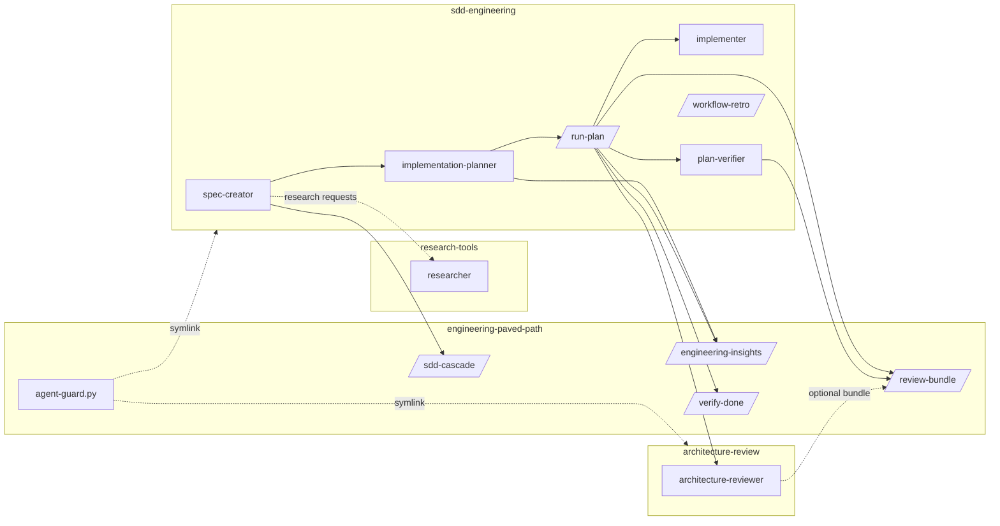

# Plan: extract the DevDigest harness into the four plugins

## Update 2026-10-14 (post-review)

The body below is the plan as written before the plugins were filled. What changed after review and testing on Claude Code 2.1.296; where the two disagree, this section wins:

- **Ranges are `^1.0.0`, not `~1.0.0`**, in the object form `{ "name", "version" }`. The string form drops the range on 2.1.296 (see `docs/architecture-decisions/2026-10-14-plugin-dependency-form-and-ranges.md`).
- **`architecture-review` is no longer dependency-free.** It depends on `engineering-paved-path` `^1.0.0`, because its agent preloads `engineering-paved-path:architecture-boundaries`.
- **Real copies, not symlinks.** `scripts/agent-guard.py` is a byte-identical copy in `architecture-review` and `sdd-engineering`; `engineering-paved-path` holds the canonical file. `scripts/check-repo.mjs` rejects symlinks under `plugins/` and compares the copies.
- **Three new shared skills in `engineering-paved-path`:** `architecture-boundaries`, `security` and `mermaid-diagram`. The project-specific architecture skills named as "not selected" below are replaced by `architecture-boundaries`, which follows the consuming project's own rules first.
- **Agents preload shared skills through `skills:`**, namespaced as `engineering-paved-path:<skill>`: `spec-creator` (`sdd-cascade`, `security`, `mermaid-diagram`), `implementation-planner` and `implementer` (`architecture-boundaries`, `security`), `architecture-reviewer` (`architecture-boundaries`). Proven in experiment 2 of the dependency ADR.
- **Versions are `1.0.0`**, not `0.1.0`, and every plugin has `CHANGELOG.md`, `COMPATIBILITY.md` (`Claude Code >=2.1.110`) and `LICENSE`. The 1.0.0 release is prepared and not yet tagged.
- **Evals** for `sdd-engineering` live in `plugins/sdd-engineering/evals/` and run with `node scripts/run-evals.mjs`.

Status: ready · Date: 2026-10-14 · Source repo: DevDigest (`HlibHav/dev-digest`), `.claude/` at `main` 45bc971.

This is the working spec for filling `plugins/*`. It covers what was picked from DevDigest, what each plugin ships, how the plugins depend on each other, the transitive dependencies the picked components drag in and what happens to each, the rules for removing DevDigest-specific paths, and what every plugin README must say.

## 1. Selected components

| Component (DevDigest source) | Kind | Plugin | Shipped as |
|---|---|---|---|
| Spec Creator (`.claude/agents/spec-creator.md`) | agent | `sdd-engineering` | `sdd-engineering:spec-creator` |
| Implementation Planner (`.claude/agents/implementation-planner.md`) | agent | `sdd-engineering` | `sdd-engineering:implementation-planner` |
| Implementer (`.claude/agents/implementer.md`) | agent | `sdd-engineering` | `sdd-engineering:implementer` |
| Plan Verifier (`.claude/agents/plan-verifier.md`) | agent | `sdd-engineering` | `sdd-engineering:plan-verifier` |
| Run-plan (`.claude/skills/implement/SKILL.md`, invoked there as `/implement`) | skill, manual only | `sdd-engineering` | `/sdd-engineering:run-plan` |
| Workflow Retro (`.claude/skills/workflow-retro/` + `scripts/collect.py`) | skill, manual only | `sdd-engineering` | `/sdd-engineering:workflow-retro` |
| Researcher (`.claude/agents/researcher.md`) | agent | `research-tools` | `research-tools:researcher` |
| Architecture Reviewer (`.claude/agents/architecture-reviewer.md`) | agent | `architecture-review` | `architecture-review:architecture-reviewer` |
| SDD cascade (`docs/sdd-cascade.md`) | doc → skill | `engineering-paved-path` | `/engineering-paved-path:sdd-cascade` |
| Engineering insights (`.claude/skills/engineering-insights/`) | skill | `engineering-paved-path` | `/engineering-paved-path:engineering-insights` |
| Review bundle (`.claude/scripts/review-bundle.sh`) | script → skill | `engineering-paved-path` | `/engineering-paved-path:review-bundle` |
| Agent guards (`.claude/hooks/agent-write-scope.py`, `agent-bash-allowlist.py`) | hooks → one script | `engineering-paved-path` (canonical), symlinked | `scripts/agent-guard.py` |
| Done gate (generalized from the owner's global `/verify` practice) | skill | `engineering-paved-path` | `/engineering-paved-path:verify-done` |

Not selected: `brainstorm`, `test-writer` (paused in DevDigest by its own ADR), `security-reviewer`, `doc-writer`, `pr-self-review`, `onion-architecture`, `frontend-ui-architecture`, the DevDigest product skills and every third-party skill in `skills-lock.json`. Those are DevDigest's own rules or someone else's work. Section 4 says how the shipped components cope without them.

## 2. What each plugin ships

**engineering-paved-path** (no dependencies). The shared floor every other plugin stands on.
- `skills/sdd-cascade/` – the tier scorecard (Direct, Lightweight SDD, Full SDD, Discovery-First), where specs live, the spec-versus-code change table. Package folders become "the package the change touches".
- `skills/engineering-insights/` – read a module's `INSIGHTS.md` before work, record confirmed lessons after. The module map is discovered (an `INSIGHTS.md` next to the code), not a fixed table.
- `skills/review-bundle/` + `scripts/review-bundle.sh` – numbered-hunk bundle for reviewers, base detected from `origin/HEAD`.
- `scripts/agent-guard.py` – the PreToolUse guard used by the plugin hooks below. Shipped here as the canonical copy; `architecture-review` and `sdd-engineering` carry a symlink to it.
- `skills/verify-done/` – the done gate: run the project's own check commands, quote the command and its result line, never claim done from a diff. This is the "verification gate, test-first done, scope discipline" the README promises.

**research-tools** (no dependencies). `agents/researcher.md`: read-only; repo or web; NotebookLM tools used only when the user has a NotebookLM MCP server, otherwise web only.

**architecture-review** (no dependencies). `agents/architecture-reviewer.md` plus `hooks/hooks.json` and a symlinked `scripts/agent-guard.py`. It reviews against the boundaries the project itself declares (CLAUDE.md, AGENTS.md, `.claude/rules/`, an architecture skill or ADRs) and runs only the boundary checks the project lists. Without a declared rule set it says so and reviews for import direction and layering it can prove from the code.

**sdd-engineering** (depends on the other three, `~1.0.0`). Four agents, `skills/run-plan/`, `skills/workflow-retro/` with `scripts/collect.py`, `hooks/hooks.json`, symlinked `scripts/agent-guard.py`.

## 3. Dependency graph

Plugin level: `sdd-engineering → {engineering-paved-path, research-tools, architecture-review}`. No other edges. `architecture-review` uses a bundle when the caller passes one and falls back to `git diff` otherwise, so it needs no dependency. Agents never start agents; every arrow from an agent to another agent is the main session dispatching it, as in DevDigest.

## 4. Transitive dependencies and what happens to each

| Dragged in by | Dependency | Decision |
|---|---|---|
| plan-verifier, architecture-reviewer, spec-creator | frontmatter `hooks` (`agent-write-scope.py`, `agent-bash-allowlist.py`, `agent-write-audit.py`) | Plugin agents ignore frontmatter `hooks` (docs: plugins/components#agents). Moved to each plugin's `hooks/hooks.json`, gated on `agent_type` inside `agent-guard.py`. The write audit is dropped: the guard denies instead of auditing after the fact. |
| plan-verifier, architecture-reviewer | `.claude/sandbox/run-tests.sh` (srt) | Dropped. Tests run with the project's own commands; the guard allows only commands the project lists (section 5). README discloses that test commands run project code. |
| run-plan, plan-verifier, architecture-reviewer | `.claude/scripts/review-bundle.sh` | Ships in `engineering-paved-path`, called as `/engineering-paved-path:review-bundle`. Lockfile and drizzle excludes kept as generic generated-file excludes. |
| spec-creator | `docs/sdd-cascade.md` | Ships as `engineering-paved-path:sdd-cascade`. |
| planner, implementer, run-plan | `engineering-insights` | Ships in `engineering-paved-path`. |
| spec-creator | preloaded `mermaid-diagram`, `security` | Not shipped. The few rules the agent used (diagram for workflows, untrusted-input section) are written into the agent body. |
| implementer, architecture-reviewer | preloaded `onion-architecture`, `frontend-ui-architecture` | Not shipped. The agents load whatever skills the plan names and whatever architecture rules the project declares. |
| planner, implementer | `pr-self-review` routing table | Replaced by: the plan names the project's skills per step; the planner discovers them from `.claude/skills/` and the project's CLAUDE.md. |
| run-plan | `security-reviewer` | Optional: use a project agent named `security-reviewer` if present, else the built-in `/security-review`. |
| run-plan | `/code-review`, `/worktree-session`, `doc-writer`, `test-writer` | `/code-review` is built in and kept. Worktree setup becomes "a feature branch or worktree". `doc-writer` and `test-writer` are dropped; implementers write red-first tests (DevDigest's current mode). |
| researcher | `mcp__notebooklm-mcp__*` tools, `nlm login`, `~/.claude/rules/research-gate.md` | NotebookLM is optional: the agent's `tools` list names the 19 NotebookLM tools it may use (query, research, create, add; no delete, share or studio tools), and without that server they grant nothing. The research gate is restated inside the agent. No absolute path. |
| workflow-retro | `collect.py`, `docs/retros/ledger.md`, `/skill-creator` | Script ships under the skill, called as `python3 ${CLAUDE_SKILL_DIR}/scripts/collect.py`. Ledger path is the project's `docs/retros/ledger.md`, created on first use. `/skill-creator` named as optional. |
| run-plan | `../decisions/`, `CLAUDE.local.md`, root CLAUDE.md Check table, `origin/main` | ADRs → `docs/architecture-decisions/` (or the project's declared folder). Checks → the project's CLAUDE.md/AGENTS.md check section. Base → `origin/HEAD`. Machine-local file mentioned only as "if present". |

## 5. Removing DevDigest-specific content

Rules every ported file follows:

1. No DevDigest package names as instructions (`server/`, `client/`, `reviewer-core/`, `e2e/`, `mcp-server/`, `repo-intel`), no DevDigest file paths (`server/src/vendor/shared/`, `route-adapter-calls.test.ts`, `.dependency-cruiser*`, `client/messages/`, `server/clones/`), no DevDigest commands (`pnpm lint:boundaries`, `pnpm db:generate`, `*.it.test.ts` as a rule). Generic wording: "each package", "the project's integration suite".
2. Project facts come from the project: its CLAUDE.md / AGENTS.md (check commands, layout, do-not-touch list), `.claude/rules/`, its skills, its ADR folder. When a fact is missing, the agent asks (spec-creator, planner) or reports it as unverifiable (verifier, reviewer). It never guesses a command.
3. Paths the plugin owns use `${CLAUDE_PLUGIN_ROOT}` or `${CLAUDE_SKILL_DIR}`; never `../`, never an absolute path, never `.claude/...` of the consumer for plugin files.
4. Cross-plugin references use full names: `research-tools:researcher`, `architecture-review:architecture-reviewer`, `/engineering-paved-path:review-bundle`.
5. Dated incident notes ("2026-10-05 mentor follow-up", "18 false partial verdicts") are kept only as the lesson, without DevDigest names.
6. Agent `name` fields have no colon; models stay as in DevDigest (opus for spec-creator and planner, sonnet for the rest).

Guard (`agent-guard.py`) contract:
- Invoked from a plugin `hooks.json` as PreToolUse, matcher `Write|Edit|MultiEdit|NotebookEdit|Bash`, with `--agent <name>=<profile>` pairs. It matches `agent_type` against `<plugin>:<name>` and bare `<name>`. Any other agent or the main session: exit 0, no output.
- Profiles: `readonly` (no writes; Bash only read-only git plus the project's listed check commands), `specs` (writes only to `specs/**/*.md` and `<dir>/specs/*.md`; no Bash), `planner` (no writes, no Bash).
- Project check commands come from `.claude/agent-guard.json` (`{ "checkCommands": ["pnpm test", "npm run typecheck"] }`), matched as exact command prefixes. No file means git-only.
- For Bash in `readonly`: backticks, `$(`, `${` and newlines are denied anywhere; `;`, `&`, `|`, `<`, `>` are denied outside quotes (a quoted `git grep -nE 'a|b'` is fine).
- Git: only read-only subcommands; `git -C` / `git -c` before the subcommand, `--output`, `-O`/`--open-files-in-pager`, `--no-index`, `--ext-diff` and `--textconv` are denied; `git branch` only lists.
- Denials are JSON `permissionDecision: "deny"` with the reason; malformed input denies for a known agent.
- Unit-tested in `test/unit/agent-guard.test.mjs`.

## 6. README requirements (every plugin)

1. One-paragraph purpose, matching `plugin.json` `description`.
2. Components table with full namespaced names, kind (agent / skill / hook / script) and one line each.
3. Dependencies with ranges, and what breaks without each.
4. Requirements on the consumer project: what it should declare (check commands, architecture rules, spec and plan folders) and what happens when it doesn't.
5. Hooks disclosed: event, matcher, what is allowed or denied, which agents they affect; "no network calls".
6. External tools needed (git, python3, optional NotebookLM MCP, optional `gh`).
7. Install (marketplace add + install) and local dev with `--plugin-dir`.
8. Provenance: extracted from DevDigest, with what was generalized.

## 7. Verification

- `scripts/check.sh` green (check-repo, `claude plugin validate` catalog and every plugin `--strict`, unit tests, build-index).
- `grep -rnE "server/|client/|reviewer-core|mcp-server|repo-intel|lint:boundaries|vendor/shared|clones|\.\./decisions|CLAUDE\.local" plugins/` returns only lines that the README explicitly mark as examples.
- Smoke: `claude --plugin-dir` with all four plugins lists the six agents and six skills under their namespaced names; the guard denies a write by `plan-verifier` and allows it for the main session.
- A fresh read-only validator checks the plugins against this plan.
