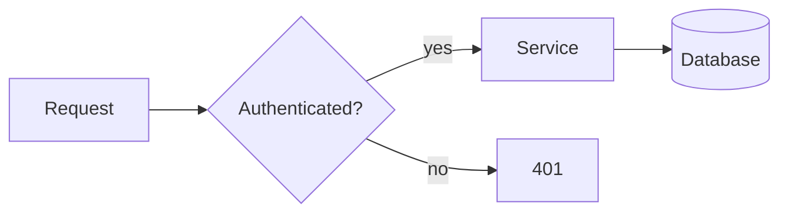
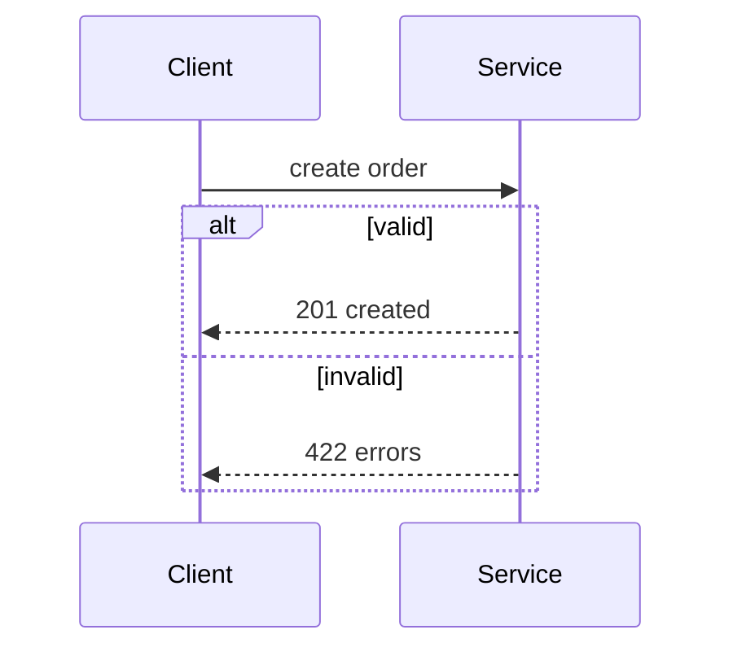
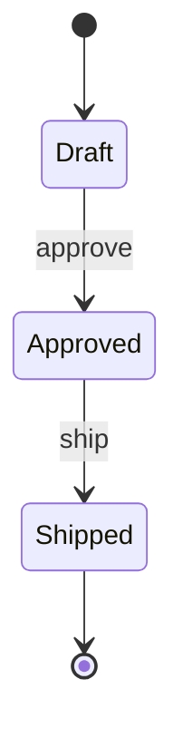

# mermaid-diagram

A diagram earns its place when it shows relationships, order or structure that a paragraph would make the reader reconstruct. Mermaid is text, so it diffs, reviews and versions like code. Write the diagram inside a fenced block marked `mermaid`.

## Pick the type

| To show | Use | Keyword |
|---|---|---|
| Steps, decisions, branches, dependencies between components | Flowchart | `flowchart TD` or `LR` |
| Calls between actors over time | Sequence diagram | `sequenceDiagram` |
| Tables and their relations | ER diagram | `erDiagram` |
| Lifecycle of one thing | State diagram | `stateDiagram-v2` |
| Types and their relations | Class diagram | `classDiagram` |
| Plan with durations | Gantt | `gantt` |
| Chronology | Timeline | `timeline` |
| Idea breakdown | Mindmap | `mindmap` |

When two types fit, choose the one a reader sees as one glance. One diagram answers one question; split when it needs more than about 12 nodes.

## Workflow

1. Write down the question the diagram answers, in one sentence.
2. List the nodes (actors, states, components) and the labelled edges between them.
3. Choose direction: `TD` for hierarchy and process, `LR` for pipelines and layers.
4. Draft, then remove every node or edge the question does not need.
5. Validate: render with the project's tool, or paste into the Mermaid live editor, or run `mmdc` if installed. A diagram that does not render is worse than none.

## Syntax that breaks

- Quote labels that contain parentheses, brackets, colons, quotes or `#`: `A["Save (draft)"]`.
- Node ids are plain words with no spaces; put the readable text in the label: `build[Build image]`.
- A word `end` in lower case ends a block; write `End` or quote it.
- In sequence diagrams, `->>` is a call, `-->>` a reply, `alt`/`else`/`end` and `loop`/`end` need closing.
- Keep one statement per line; a stray semicolon or missing `end` is the usual render error.
- Style sparingly. Colour is for emphasis on one or two nodes, and the diagram must still read in light and dark themes.

## Minimal examples

Flowchart:

Sequence:

State:

More templates, including ER and Gantt, are in [references/examples.md](references/examples.md).

## Checklist before you hand it over

- Does it answer the one question you wrote down?
- Are all labels short (under about five words) and consistent in naming with the surrounding text?
- Did you check it renders?
- Is there a sentence of prose beside it saying what to look at? A diagram without a caption still makes the reader guess.
