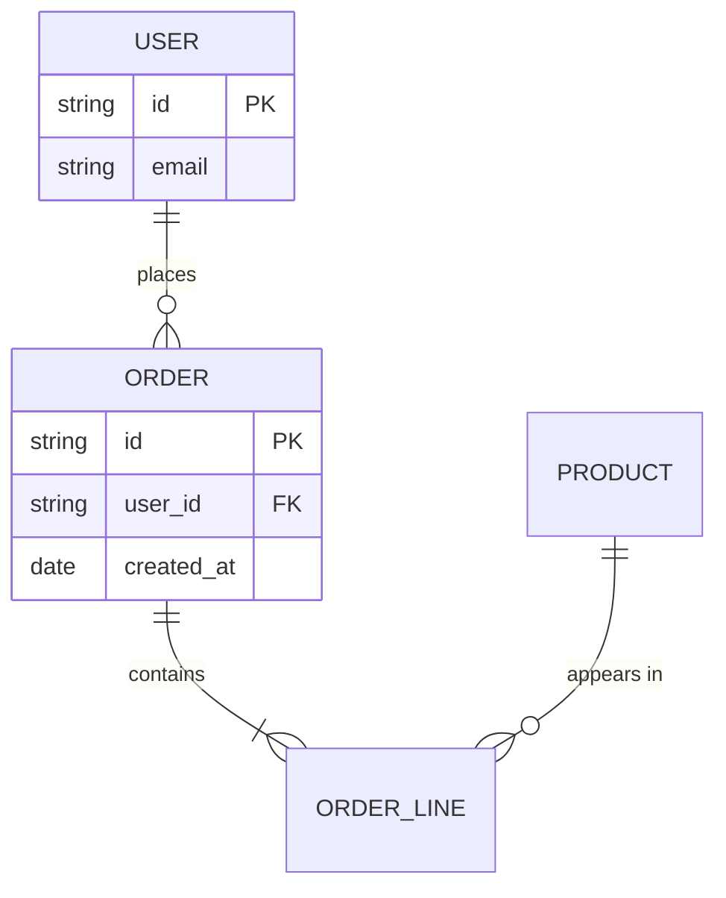
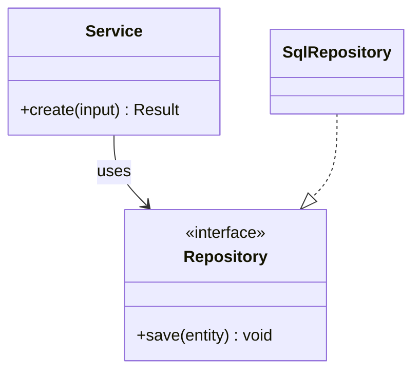
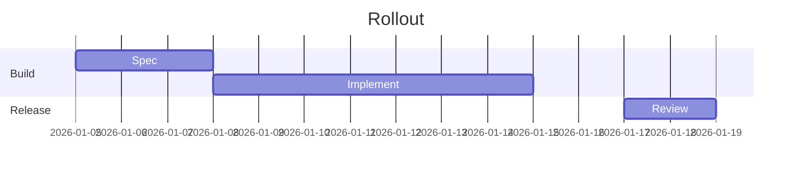
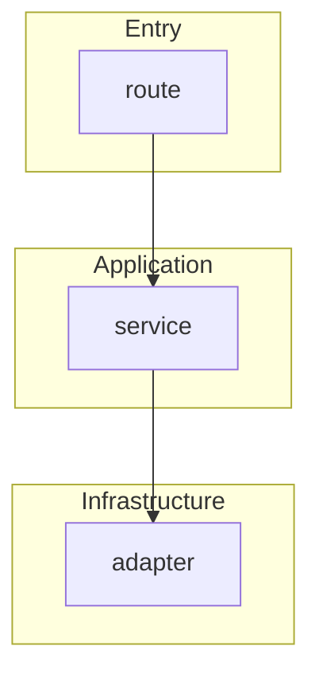

# Mermaid templates

Contents: ER, class, Gantt, subgraphs, notes.

## ER diagram

Cardinality marks: `||` exactly one, `o|` zero or one, `}o` zero or many, `}|` one or many.

## Class diagram

Arrows: `<|--` inheritance, `*--` composition, `o--` aggregation, `-->` association, `..>` dependency, `..|>` implements.

## Gantt

## Subgraphs for layers

## Notes and dashed links

Use `-.->` for optional or indirect relations and `==>` sparingly for the main path. A note in a sequence diagram: `Note right of S: validates input`.
