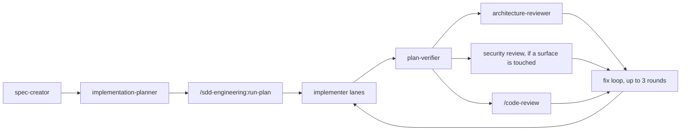

# sdd-engineering

Spec-driven workflow: idea to spec to plan, delegating research and architecture review.

The plugin turns a feature request into a spec, the spec into an ordered plan, and the plan into
reviewed code. Four agents do the work, `/sdd-engineering:run-plan` conducts the implementation half, and
`/sdd-engineering:workflow-retro` turns a finished multi-agent run into lessons. Agents never start agents:
the main session dispatches each one, passes artifacts between them and relays their questions.

## Components

| Name | Kind | What it does |
|---|---|---|
| `sdd-engineering:spec-creator` | agent | Picks how much spec a change needs, asks the blocking questions, writes the spec (writes only `specs/**/*.md`, no Bash). |
| `sdd-engineering:implementation-planner` | agent | Turns an approved spec into an ordered, test-first plan with lanes and check commands. Read-only, no Bash. |
| `sdd-engineering:implementer` | agent | Executes one lane or a whole plan: code and red-first tests, targeted checks, an Implementation Report. Also runs in fix mode. |
| `sdd-engineering:plan-verifier` | agent | Read-only. Gives every plan item a verdict with evidence and maps every changed hunk to a plan item. |
| `/sdd-engineering:run-plan` | skill (manual) | Runs implementer lanes, package gate, reviews, fix loop (up to 3 rounds) and close from a saved plan. |
| `/sdd-engineering:workflow-retro` | skill (manual) | Retrospective of a multi-agent run; keeps a lesson ledger and proposes diffs for lessons seen twice. |
| `scripts/agent-guard.py` | script | PreToolUse guard used by the hook. A symlink to the canonical copy in `engineering-paved-path`. |
| `hooks/hooks.json` | hook | Enforces the read-only and write-scope profiles of three agents (see Hooks). |
| `skills/workflow-retro/scripts/collect.py` | script | Stdlib-only transcript parser behind `workflow-retro deep`. |

## The chain



`spec-creator` and `implementation-planner` are run by hand. `run-plan` starts from a saved plan
and never writes a spec or a plan; when it finds one wrong, it stops and says which agent to run.

Before running `sdd-engineering:spec-creator`, load `/engineering-paved-path:sdd-cascade` in the main session and paste its text into the brief, or name the tier yourself (Direct, Lightweight SDD, Full SDD, Discovery-First); without either it returns one blocking question.

## Dependencies

| Plugin | Range | Provides | Without it |
|---|---|---|---|
| `engineering-paved-path` | `~1.0.0` | `sdd-cascade`, `engineering-insights`, `review-bundle`, `verify-done`, and the canonical `agent-guard.py` | No tier scorecard for the spec, no review bundles for the reviewers, no insights step, and the hook script link breaks. |
| `research-tools` | `~1.0.0` | `research-tools:researcher`, which `spec-creator` asks for through the main session | Research requests have no agent to go to. |
| `architecture-review` | `~1.0.0` | `architecture-review:architecture-reviewer`, used in `run-plan` Step 2 | The architecture review step has no reviewer. |

## What your project should provide

- **Check commands** (typecheck, unit tests, integration and e2e if any) in `CLAUDE.md` or
  `AGENTS.md`. Agents never guess a command; a missing one is asked for or reported unverifiable.
- **`.claude/agent-guard.json`** with `{ "checkCommands": ["npm test", "npm run typecheck"] }`.
  `plan-verifier` can run only read-only git and these commands, as exact prefixes. Without the
  file it gets git only, and `run-plan` tells you which commands to add.
- **`specs/` and `docs/plans/` folders** (package-level `<dir>/specs/` also works). Specs, plans
  and the `*.state.md` file of a run live there.
- Optional: an ADR folder (default `docs/architecture-decisions/`), `INSIGHTS.md` files beside
  modules, a project `security-reviewer` agent (otherwise `/security-review` is used), a
  NotebookLM MCP server for `research-tools:researcher`.

## Hooks

One `PreToolUse` hook, matcher `Write|Edit|MultiEdit|NotebookEdit|Bash`. It fires on every such
tool call in a session, then acts only when the calling agent is one of:

- `spec-creator`: writes only Markdown under a `specs/` directory; no Bash.
- `implementation-planner`: no writes, no Bash.
- `plan-verifier`: no writes; Bash limited to read-only git and the commands in `checkCommands`.

- The guard acts only when the hook input's `agent_type` matches a guarded agent. For those agents, malformed tool input is denied. Input with no `agent_type` (the main session, other agents) passes silently.
- Denied shell characters for read-only agents: `;`, `&`, `|`, `<` and `>` outside quotes, and backticks, `$(`, `${` and newlines anywhere.
- Allowed git: read-only subcommands (`diff`, `log`, `show`, `status`, `blame`, `merge-base`, `rev-parse`, `ls-files`, `grep`, `cat-file`, branch listing, `describe`, `shortlog`). Denied: `git -C`, `git -c` (options before the subcommand), `--output`, `-O`, `--no-index`, `--ext-diff`, `--textconv`.

`implementer` and the main session are not restricted and exit silently. A denial is a PreToolUse
`deny` decision with a reason. The hook reads the tool input and one local config file, writes
nothing and makes **no network calls**. Test commands you list in `checkCommands` run your own
project code.

## External tools

`git`, `python3` (hook and `collect.py`), and optionally `gh` for opening a PR.

## Install

```
/plugin marketplace add HlibHav/dev-digest-ai-marketplace
/plugin install sdd-engineering@dev-digest-ai-marketplace
```

Dependencies install with it. For local development, load all four plugins from a checkout:

```
claude \
  --plugin-dir plugins/engineering-paved-path \
  --plugin-dir plugins/research-tools \
  --plugin-dir plugins/architecture-review \
  --plugin-dir plugins/sdd-engineering
```

## Provenance

Extracted from the DevDigest project's `.claude/` harness. Package names, project paths, its
sandbox runner, write audit and review-bundle script path were replaced with project-declared
facts and the shared `engineering-paved-path` components; see `docs/plans/2026-10-14-plugin-extraction.md`.
