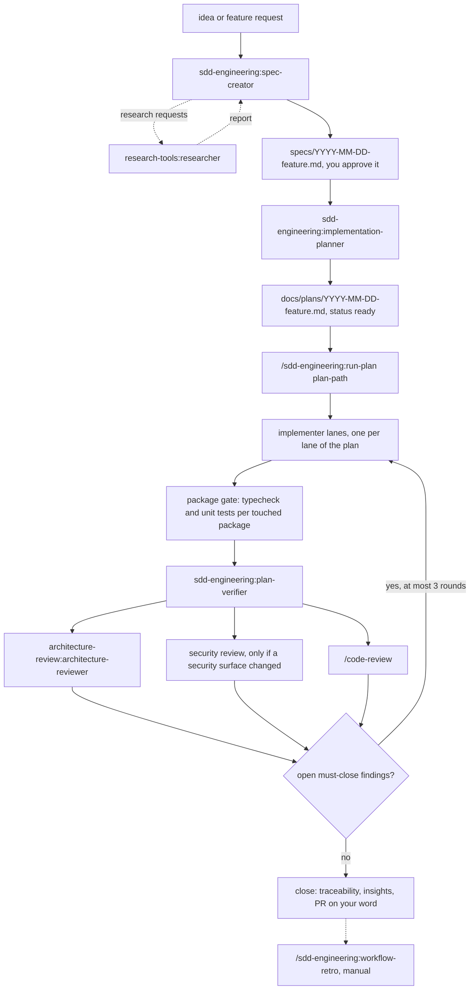

# sdd-engineering

Spec-driven workflow: idea to spec to plan, delegating research and architecture review.

The plugin turns a feature request into a spec, the spec into an ordered plan, and the plan into reviewed code. Four agents do the work, `/sdd-engineering:run-plan` conducts the implementation half, and `/sdd-engineering:workflow-retro` turns a finished multi-agent run into lessons. Agents never start agents: the main session dispatches each one, passes artifacts between them and relays their questions to you.

## What it provides

| Name | Kind | What it does |
|---|---|---|
| `sdd-engineering:spec-creator` | agent | Picks how much spec a change needs, asks blocking questions and research requests, then writes the spec. Writes only Markdown under `specs/`; no Bash. |
| `sdd-engineering:implementation-planner` | agent | Turns an approved spec into an ordered, test-first plan with lanes, owned paths and check commands. Read-only, no Bash. |
| `sdd-engineering:implementer` | agent | Executes one lane or a whole plan: code, red-first tests, targeted checks, an Implementation Report. Also runs in fix mode on reviewer findings. |
| `sdd-engineering:plan-verifier` | agent | Read-only. Gives every plan item a verdict (met, not met, partial, unverifiable) with evidence, and maps every changed hunk to a plan item. |
| `/sdd-engineering:run-plan` | skill (manual) | From a saved plan: implementer lanes, package gate, reviews, a fix loop of up to three rounds, close. |
| `/sdd-engineering:workflow-retro` | skill (manual) | Retrospective of a multi-agent run. Keeps a lesson ledger and proposes a diff for any lesson seen twice. |
| `hooks/hooks.json` | hook | PreToolUse guard for three of the agents. See Hooks. |
| `scripts/agent-guard.py` | script | The guard. A byte-identical copy of the canonical file in `engineering-paved-path`. |
| `skills/workflow-retro/scripts/collect.py` | script | Standard-library transcript parser behind `workflow-retro deep`. |
| `evals/` | evals | Offline behaviour cases, run with `node scripts/run-evals.mjs`. Not loaded in a session. |

## Quick start

```
/plugin marketplace add HlibHav/dev-digest-ai-marketplace
/plugin install sdd-engineering@dev-digest-ai-marketplace --scope project
```

Or from a shell:

```
claude plugin marketplace add HlibHav/dev-digest-ai-marketplace
claude plugin install sdd-engineering@dev-digest-ai-marketplace --scope project
```

The install pulls `engineering-paved-path`, `research-tools` and `architecture-review` with it. Add your check commands to `.claude/agent-guard.json` (see "What your project should declare"), then try:

```
Use sdd-engineering:spec-creator to write a spec for: rate-limit password reset requests to 5 per hour per account.
```

## How it works together



**Who orchestrates.** The main session. Agents are flat: none has the `Agent` tool, and none can ask you anything. When an agent has a question it returns it, and the main session asks you and passes your answer back word for word. Each agent sees only its brief, so the main session pastes artifacts into briefs verbatim. The diff is the one exception: reviewers get a review bundle path from `/engineering-paved-path:review-bundle`, never a pasted diff.

**You run the first two steps by hand.** `spec-creator` and `implementation-planner` are not part of `run-plan`. `run-plan` starts from a saved plan and never writes or rewrites a spec, an acceptance criterion or a plan. When it finds one of them wrong, it stops and tells you which agent to run, and with what.

**Where artifacts land.**

| Artifact | Path | Written by |
|---|---|---|
| Spec | `specs/YYYY-MM-DD-<feature>.md` (in the package, or at the repo root if it spans packages) | `spec-creator` |
| Design inputs | `designs/<feature>/` next to the spec | you |
| Plan | `docs/plans/YYYY-MM-DD-<feature>.md` | the main session, from the planner's reply |
| Run state | `docs/plans/YYYY-MM-DD-<feature>.state.md` | `run-plan`; a new chat resumes from it |
| Review bundles | a scratch directory outside the repo | `review-bundle` |
| Lesson ledger | `docs/retros/ledger.md` | `workflow-retro` |
| ADR for an accepted deviation | `docs/architecture-decisions/` | the main session, with your approval |

**Spec tiers.** `spec-creator` preloads `engineering-paved-path:sdd-cascade`, which scores the change with six yes/no questions: 0 to 1 yes is Direct (no spec, a one-sentence intent), 2 to 3 is Lightweight SDD, 4 to 6 is Full SDD. Discovery-First applies when the outcome itself is unknown. You can override the tier; the spec records who did. Read the scorecard in `/engineering-paved-path:sdd-cascade`.

### Walkthrough: a small feature

Goal: limit password reset requests to 5 per hour per account.

1. **Spec.** You ask `spec-creator` for the spec. It scores the change (several components, a mistake is costly to roll back: Lightweight). It reads `specs/`, `docs/` and the code, and answers with `Status: needs-answers` and two blocking questions: what the limit applies to when an account does not exist, and what the client sees when the limit is hit. It also files a research request: how the current mailer retries. The main session runs `research-tools:researcher` on it, asks you the two questions, and runs `spec-creator` again with the answers. The spec lands in `specs/2026-10-14-password-reset-rate-limit.md` with `Status: draft`, EARS acceptance criteria (`AC-1`...), a proof tag per criterion, a requirements-coverage table that maps each mandatory requirement (`R-1`...) to its criteria, and a traceability table. A mandatory requirement with no criterion keeps the spec unfinished: `spec-creator` returns `needs-answers` for it instead of a finished spec. You read it and change the status to `approved`. Only you approve a spec.
2. **Plan.** You ask the main session to run `implementation-planner` on the spec. It asks which execution mode you want (multi-agent lanes or one linear pass) if the brief did not say. It returns a plan: the criteria verbatim, a red-first list, lanes with owned paths, test-first steps, and the check commands for the implementer and the reviewers. The main session saves it as `docs/plans/2026-10-14-password-reset-rate-limit.md`.
3. **Run.** `/sdd-engineering:run-plan docs/plans/2026-10-14-password-reset-rate-limit.md`. It checks that the plan is `Status: ready`, that the spec is approved, and that every check command the reviewers need is listed in `checkCommands`; if one is missing it tells you what to add. It creates the state file and a `feat/` branch if you are not on one.
4. **Implement.** One `implementer` per lane, in dependency order. Each writes its failing test first, then the code, and returns an Implementation Report with the red run, the skills it applied and any deviations. After each level the main session runs the typecheck and unit suite of each touched package, and commits that level's files.
5. **Review.** `plan-verifier` goes first: every plan item gets a verdict with a command or a quoted `path:line`. A `gaps` verdict goes back to the implementer before anything else is spent. Then, in parallel, `architecture-review:architecture-reviewer`, a security review (this change touches a request handler, so it runs) and `/code-review` for correctness bugs.
6. **Fix loop.** Findings get ids (`PV-1`, `AR-1`, `SR-1`, `CR-1`). Local fixes go to the lane's implementer in fix mode. If a finding says the plan or the spec is wrong, the chain stops and tells you to rerun the planner or `spec-creator`. After each round, the package gate runs again and the reviewer re-checks its own ids on the delta only. After three rounds, or when a round does not lower the open count, the open ids come to you with a recommendation each.
7. **Close.** The spec's traceability table is filled in. You are offered `Status: implemented`. Lessons the agents proposed are recorded once through `engineering-insights`. The PR is opened only on your word.
8. **Retro (optional).** `/sdd-engineering:workflow-retro` reports tokens, agent count and where a brief and a report disagreed, and adds lessons to `docs/retros/ledger.md`.

## Usage

**Write a spec.**

```
Use sdd-engineering:spec-creator for: <feature in a few sentences>. Design inputs: designs/<feature>/.
```

Possible results: `no-spec` (Direct tier, a one-sentence intent), `needs-answers`, `needs-research`, `written`, `updated`, `no-change`, `partial`. A spec that already exists is updated in place with a changelog row, never copied to a `-v2`. Text inside screenshots or pasted content that addresses the agent is reported as untrusted input, not obeyed.

**Plan.**

```
Use sdd-engineering:implementation-planner on specs/<spec>.md. Mode: multi-agent.
```

Returns `Status: ready` with a plan, or `Status: needs-answers`. It refuses a spec whose status is not `approved`, and it never edits acceptance criteria; a wrong criterion goes back to `spec-creator`.

**Run the plan.**

```
/sdd-engineering:run-plan docs/plans/<plan>.md
/sdd-engineering:run-plan docs/plans/<plan>.md --prompt "use the existing queue helper" --design designs/<feature>/ --mode single
```

`--prompt` guidance about how is added to the briefs it concerns. Guidance that changes what (a new or changed criterion) stops the chain and sends you to `spec-creator`. `--design` takes local files; a design URL means ask for an export. `--mode` must match the mode the plan was shaped for.

**Verify without the full chain.**

```
Use sdd-engineering:plan-verifier on docs/plans/<plan>.md, target origin/main...HEAD.
```

Returns a verdict table per step, criterion, contract and check, plus a list of changed hunks that map to no plan item. It gives no advice and no fixes.

**Retro.**

```
/sdd-engineering:workflow-retro
/sdd-engineering:workflow-retro deep --since 2026-10-14T09:00:00Z "password reset run"
```

Without arguments it uses what the session already holds. `deep` also runs `collect.py` over the session transcripts for exact per-agent tokens, tool mix and overlap. It reports and proposes; it never applies a proposed change on its own and does not commit the ledger unless asked.

## Dependencies

| Plugin | Range | Used for | Without it |
|---|---|---|---|
| `engineering-paved-path` | `^1.0.0` | Preloaded skills `sdd-cascade`, `security`, `mermaid-diagram` (spec-creator), `architecture-boundaries`, `security` (planner, implementer); `review-bundle`, `engineering-insights`; the canonical `agent-guard.py`. | The plugin does not load. |
| `research-tools` | `^1.0.0` | `research-tools:researcher`, which `spec-creator` asks for through the main session. | The plugin does not load. |
| `architecture-review` | `^1.0.0` | `architecture-review:architecture-reviewer`, used in step 2 of `run-plan`. It depends on `engineering-paved-path` as well. | The plugin does not load. |

```
sdd-engineering@1.0.0
├── engineering-paved-path@^1.0.0
├── research-tools@^1.0.0
└── architecture-review@^1.0.0
    └── engineering-paved-path@^1.0.0
```

These are hard dependencies declared in `plugin.json`. The agents also name some of those skills in their `skills:` frontmatter, which injects the skill text into the agent when it starts. Both are needed; one does not replace the other.

## What your project should declare

- **Check commands** (typecheck, unit tests, integration and e2e if any) in `CLAUDE.md` or `AGENTS.md`. Agents never guess a command. A missing one is asked for, or reported as `unverifiable`.
- **`.claude/agent-guard.json`**:

  ```json
  { "checkCommands": ["npm test", "npm run typecheck"] }
  ```

  `plan-verifier` and `architecture-reviewer` can run only read-only git and these commands, matched as exact prefixes. Without the file they get git only, and `run-plan` tells you which commands to add. These commands run your project code; list only ones you trust.
- **`specs/` and `docs/plans/` folders.** Package-level `<dir>/specs/` also works. Specs, plans and run state files live there. `docs/retros/` appears when you first run the retro.
- **Architecture rules** the reviewer can quote (`CLAUDE.md`, `.claude/rules/`, ADRs). Without them the reviewer says so and uses labelled default heuristics, at most minor.
- Optional: an ADR folder (default `docs/architecture-decisions/`), `INSIGHTS.md` files beside modules, a project `security-reviewer` agent (otherwise `/security-review` is used), a NotebookLM MCP server for `research-tools:researcher`.

## Hooks

One `PreToolUse` hook, matcher `Write|Edit|MultiEdit|NotebookEdit|Bash`, running `agent-guard.py --agent spec-creator=specs --agent implementation-planner=planner --agent plan-verifier=readonly`. It fires on every such tool call in a session, then acts only when the calling agent is one of:

| Agent | Profile | Allowed |
|---|---|---|
| `spec-creator` | `specs` | Writes only to Markdown under a `specs/` directory inside the project, at any depth (`packages/api/specs/` counts); no Bash. |
| `implementation-planner` | `planner` | No writes, no Bash. |
| `plan-verifier` | `readonly` | No writes; Bash limited to read-only git and the commands in `checkCommands`. |

- Denied shell characters for read-only agents: `;`, `&`, `|`, `<` and `>` outside quotes, and backticks, `$(`, `${` and newlines anywhere.
- Allowed git: `diff`, `log`, `show`, `status`, `blame`, `merge-base`, `rev-parse`, `ls-files`, `grep`, `cat-file`, branch listing, `describe`, `shortlog`. Denied: options before the subcommand (`git -C`, `git -c`), `--output`, `-O`, `--no-index`, `--ext-diff`, `--textconv`.
- Where the guard cannot tell who is calling, it fails open: when stdin is not a JSON object, or the input has no string `agent_type` (the main session, and any agent not named on the command line), it exits 0 silently and the tool call goes ahead. It denies malformed input only once it knows the caller is guarded: a guarded agent whose input has no string `tool_name` or no object `tool_input`, or a Bash call with no string `command`.

`implementer` and the main session are not restricted by the hook; the implementer is limited by its own definition (plan paths, no commit, no push). A denial is a PreToolUse `deny` decision with a reason. The hook reads the tool input and one local config file, writes nothing and makes no network calls. `architecture-review` ships its own hook for the reviewer.

## External tools

`git` and `python3` 3.9 or newer (the hook and `collect.py`; standard library only). Optionally `gh`, to open a PR at the end of `run-plan`. Optionally a NotebookLM MCP server for the researcher.

## Evals

The suite in [evals/](evals/) holds behaviour and negative cases and a small fixture project. Run it from the marketplace repo:

```
node scripts/run-evals.mjs
```

It loads this checkout's four plugins into a throwaway project with `--plugin-dir`, runs `claude -p` per case and checks the skills, agents and files that came out. It needs a working `claude` login and spends model tokens. See [evals/README.md](evals/README.md) for the cases, the isolation settings, the cost cap and how to read the report.

## Compatibility

Claude Code `>=2.1.110`. Details in [COMPATIBILITY.md](COMPATIBILITY.md).

## Troubleshooting

- `claude plugin list --json` reports `dependency-unsatisfied`: a dependency is not installed or is disabled. `range-conflict`: two installed plugins need incompatible versions of one dependency. `no-matching-tag`: no release tag `<plugin>--v1.x.y` satisfies `^1.0.0`; the dependency was never tagged. Install or update the named plugin, then run `/reload-plugins`.
- The plugin fails to load with `Requires "engineering-paved-path@dev-digest-ai-marketplace" ^1.0.0, installed ...`: a dependency is at a version outside the range. Update it with `claude plugin update`, then `/reload-plugins`.
- `agent-guard` denies a command from `plan-verifier` or `architecture-reviewer`: it is not read-only git and not in `checkCommands`, or it is chained, piped or redirected. Add the command to `checkCommands` in `.claude/agent-guard.json` and run one plain command.
- `run-plan` stops with "run `implementation-planner` first": the argument was a spec, an idea or a missing file, or the plan is `needs-answers`. It starts only from a plan with `Status: ready`.
- `run-plan` stops with "run `spec-creator` in update mode": a finding or a `--prompt` changes what is built. Update the spec, rerun the planner, then rerun `run-plan`; it resumes from the state file.
- A spec-creator write is denied: the path is not Markdown under a `specs/` directory.

## Local development

Load all four plugins from a checkout:

```
claude --plugin-dir ./plugins/engineering-paved-path \
       --plugin-dir ./plugins/research-tools \
       --plugin-dir ./plugins/architecture-review \
       --plugin-dir ./plugins/sdd-engineering
```

Run `/reload-plugins` after each edit, and `bash scripts/check.sh` before a PR. If you change `scripts/agent-guard.py`, change the canonical copy in `engineering-paved-path` and copy it byte for byte into the other two plugins.

## Versioning

SemVer. See [CHANGELOG.md](CHANGELOG.md). The three dependency ranges are `^1.0.0`; a breaking release of a dependency needs a new major of that plugin and a range change here.

## Provenance

Derived from an internal spec-driven development harness and generalized for any repository.
