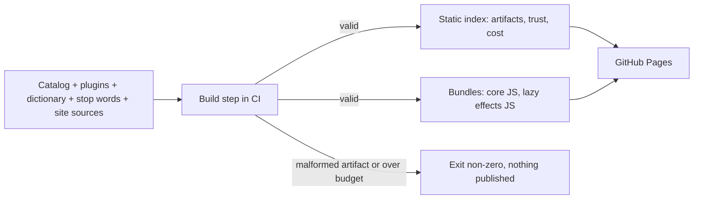
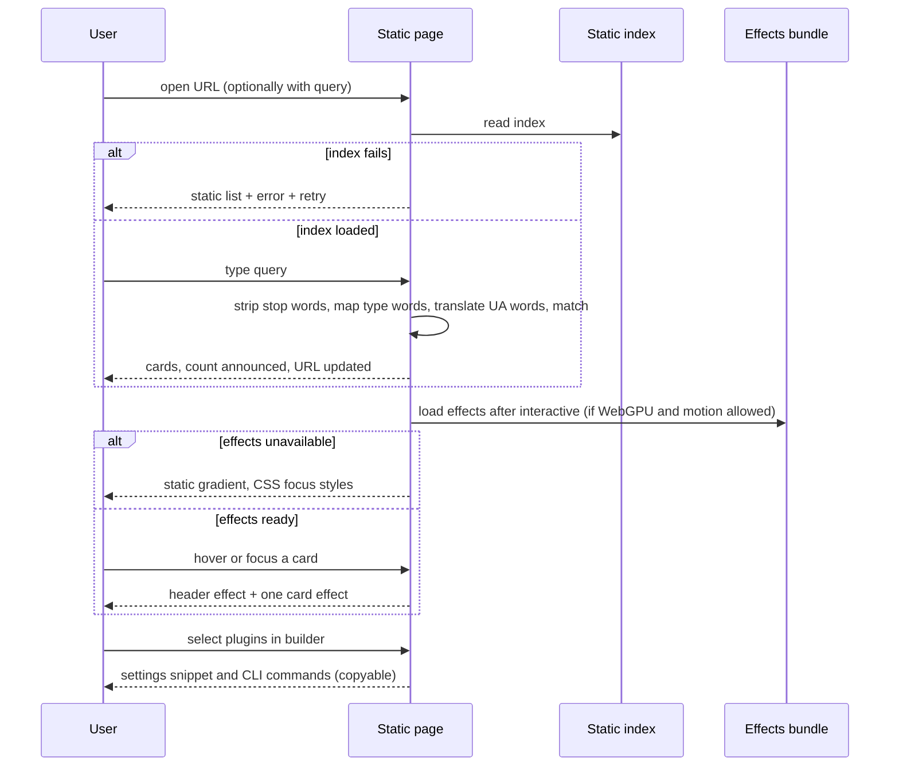

# Spec: Catalog search, install builder, trust profile, context cost and visual effects

Spec ID: SPEC-2026-10-14-catalog-search
Status: approved (Glib, 2026-10-14)
Tier: Full SDD (scorecard 6/6)
Supersedes: none. Extends the skeleton in `docs/SITE-SPEC.md`; once this spec is approved, SITE-SPEC.md points here.
Packages: marketplace repo (build script, published static site, CI)
Design sources: owner text, 2026-10-14: a static GitHub Pages catalog with natural-language (Ukrainian/English) search over all artifacts, an install builder, a per-plugin trust profile, a per-plugin context-cost estimate, and active WebGPU visual effects (header background and per-card effects), written in-house after a spike rejected the `shaders` package. No screenshots or Figma.
Decision record: [docs/architecture-decisions/2026-10-14-catalog-stack.md](../docs/architecture-decisions/2026-10-14-catalog-stack.md)

## Problem and user

The Pages site today is one HTML page with a card per plugin and no search. A person who needs "a skill that reviews architecture" cannot find a skill, agent, command, hook or MCP server inside a plugin, cannot see what a plugin will run on their machine, and cannot see what it costs in context. Installing a plugin with dependencies means hand-assembling commands and a settings snippet.

Users: (1) a Claude Code user, often Ukrainian-speaking, looking for a capability and wanting to install it safely; (2) a team lead composing a `.claude/settings.json` for a project; (3) a plugin author checking how their plugin looks in the catalog.

## Outcome and metrics

- A user finds a relevant artifact with a plain-language UA or EN query on the first try; the result card tells them which plugin to install.
- A user produces a correct `.claude/settings.json` snippet, with all transitive dependencies, without reading `plugin.json` files.
- A reader sees, before installing, which hooks and MCP servers a plugin carries and roughly what it costs in context.
- The catalog feels alive (shader effects) without costing search speed, accessibility or battery.
- Metrics (fixture marketplace and real catalog): query-to-results time (AC-43), index size (AC-41), build time (AC-45), initial JS size (AC-55). Search quality is checked with a curated query list (AC-12 to AC-17).

## Goals / Non-goals

Goals
- G1 Search over all six artifact types: plugin, skill, agent, command, hook, MCP server.
- G2 Install builder with automatic transitive dependencies.
- G3 Static trust profile per plugin.
- G4 Estimated context cost per plugin.
- G5 Everything computed at build time; the browser only reads static files.
- G6 The build fails on malformed artifacts, so it doubles as the missing frontmatter validation.
- G7 WebGPU visual effects on the header and the cards, as progressive enhancement.

Non-goals (this spec)
- The site is a catalog, never an install source: no Pages URL is ever offered as a marketplace source.
- No backend, no accounts, no analytics, no telemetry, no secrets in the browser.
- The trust profile does not certify, scan for malware or rate safety. It describes.
- No resolution of dependency ranges against release tags.
- No LLM or model call at build or run time.
- No third-party visual-effects library.

Future phases (out of scope, no ACs): dependency graph; version history from `<plugin>--v<semver>` tags (including a "no matching release tag yet" hint); "didn't find it, request it" prefilled GitHub issue; per-artifact detail page; semantic (embedding) search as an optional mode; a dictionary-miss hint ("we did not translate 'X'").

## User stories

- As a user I type "мені треба скіл для рев'ю архітектури" and see skills about architecture review, each naming its plugin and a copyable install command.
- As a user I share the URL of my search and a colleague sees the same results.
- As a team lead I tick `sdd-engineering` and its three dependencies are added automatically, with a settings snippet and CLI commands I can copy.
- As a cautious user I see on a plugin card that it has a `PreToolUse` hook and a non-loopback HTTP MCP server before I install.
- As an author I see my plugin's always-loaded token estimate and notice when it grows.
- As any visitor I see a live header and a glow on the card I hover or focus, coloured by artifact type; on a browser without WebGPU or with reduced motion I see a calm static version.

## Existing behaviour (facts the spec builds on)

- `scripts/build-index.mjs` reads the catalog and each `plugin.json` and writes `site/index.json` and a server-rendered `site/index.html` with one card per plugin; the list is readable without JS.
- `scripts/build-index.mjs` keeps only dependency names and drops the version range. The builder needs the range, so the index contract changes.
- The build already exits non-zero on a missing manifest, missing version or malformed dependencies; it does not read skills, agents, commands, hooks or MCP config. `CONTRIBUTING.md` says `check.sh` does not validate skill and agent frontmatter, so this build becomes that check.
- `scripts/check.sh` runs `check-repo.mjs`, `claude plugin validate`, then the build; `.github/workflows/validate.yml` runs it on PRs and pushes to main, so a failing build blocks PRs.
- `scripts/check-repo.mjs` rejects any directory under `plugins/` that is not in the catalog, so test fixture plugins cannot live under `plugins/` (AC-3).
- `.gitignore` ignores `site/`, so the `site/**` trigger in `.github/workflows/pages.yml` never fires; the triggers also omit skills, agents, commands, hooks, `.mcp.json`, the dictionary and the site sources. AC-4 fixes this.
- The repo has no `package.json` today; every script is zero-dependency Node. This spec introduces one (see the decision record).
- All declared dependencies use `~1.0.0`, every plugin is at `0.1.0`, no release tags exist, and plugins have no skills yet.
- Plugin layout and namespacing (from the Claude Code plugin docs, restated because `docs/temp/` is deleted later): skills `skills/<s>/SKILL.md`, agents `agents/*.md`, commands `commands/*.md`, hooks `hooks/hooks.json` with a top-level `hooks` key, MCP servers `.mcp.json`, helper scripts `scripts/`. `plugin.json` may also declare `hooks` and `mcpServers` inline or by path; these merge with the default files. Skills are invoked `/<plugin>:<skill>` where a frontmatter `name` replaces the folder name; commands `/<plugin>:<file>` with a subfolder adding a segment; agents `<plugin>:<agent>`; MCP tools `mcp__plugin_<plugin>_<server>__<tool>`.

## Acceptance criteria (EARS)

Proof tags: `red-first unit` | `red-first integration` | `e2e` | `browser (main session)`. "Fixture marketplace" means a test-only marketplace (catalog, plugins, dictionary) kept outside the published `plugins/` directory (AC-3).

### A. Build, index and CI

- AC-1 WHEN the build runs, the system shall emit one static index describing every plugin in the catalog and every skill, agent, command, hook and MCP server found inside those plugins, each with a type, name, owning plugin, description and, where applicable, body text. Proof: red-first integration. Verify: build a fixture with one plugin holding 1 skill, 1 agent, 1 command, a hooks.json with 2 hooks and a .mcp.json with 2 servers; expect 1 plugin entry and 7 artifact entries with correct types and owning plugin.
- AC-2 WHEN the build discovers artifacts, the system shall give each its namespaced name: skill `/<plugin>:<frontmatter name or folder name>`, command `/<plugin>:<file name>` (a subfolder adds a `:<folder>` segment), agent `<plugin>:<agent>`, MCP server `<plugin>/<server>`, hook `<plugin>/<event>#<index>`. Proof: red-first unit. Verify: plugin `demo` with skill folder `review` (no name), skill folder `x` with `name: audit`, command `commands/ops/deploy.md`; expect `/demo:review`, `/demo:audit`, `/demo:ops:deploy`.
- AC-3 WHERE the build is pointed at a fixture marketplace outside the published catalog, the system shall build from it exactly as from the real catalog, and shall never include fixture content in the deployed site. Proof: red-first integration. Verify: build the real catalog and the fixture in turn; the real index holds no fixture names, and the fixture build succeeds although its plugins are not in `plugins/`.
- AC-4 WHEN a push to main changes any indexed source (catalog, any `plugin.json`, skill, agent, command, hook config, MCP config, the UA→EN dictionary, the stop-word lists, the site sources or the lockfile), the system shall rebuild and redeploy the site. Proof: browser (main session), plus red-first integration asserting the trigger list covers each indexed source path. Verify: merge a one-line `SKILL.md` change; a Pages run starts and the new description appears live.
- AC-5 IF an artifact or curated file is malformed, THEN the build shall exit non-zero, name the file and the rule broken, and publish nothing. Proof: red-first unit. Verify, one fixture each: skill without `description`; agent without frontmatter or without `description` (an agent's `name` defaults to its file stem; a command's frontmatter is optional and its description falls back to the first non-empty body line, at most 200 characters); invalid JSON in `hooks.json`; `hooks.json` without a top-level `hooks` key; invalid JSON in `.mcp.json`; two artifacts with the same namespaced name in one plugin; dependency naming a plugin not in the catalog; dependency cycle; non-semver or non-`~` range; dependency given as a bare string; duplicate key in the dictionary; dictionary value that is not a non-empty list of words. Expect exit non-zero, an error line with path and rule, and no index written.
- AC-6 WHEN a skill frontmatter `name` differs from its folder name, the system shall use the frontmatter `name` for the namespaced name and show the folder path as the source location, and shall not fail. Proof: red-first unit. Verify: folder `x`, `name: audit`; expect name `/demo:audit` and source `plugins/demo/skills/x/SKILL.md`.
- AC-7 WHEN a plugin declares hooks or MCP servers inline in `plugin.json`, by a custom path in `plugin.json`, or in its catalog entry, the system shall read them together with the default `hooks/hooks.json` and `.mcp.json` and include all of them in the index and the trust profile, recording the source of each. Proof: red-first unit. Verify: fixture with one hook in `hooks/hooks.json`, one inline in `plugin.json`, one MCP server in `.mcp.json` and one at a custom path; expect 2 hooks and 2 servers, each with its source file.
- AC-8 WHEN the built site is used, it shall make no request to any origin other than its own: all scripts, styles, fonts, WebGPU code and data are served same-origin. Proof: e2e. Verify: load the site with network logging, search, build an install, hover cards; every request is same-origin.
- AC-9 WHILE the build runs in CI, it shall use no network access to produce the index and site, beyond installing locked dependencies in a prior step. Proof: red-first integration. Verify: after install, run the build with outbound network disabled; expect success and an identical index.
- AC-10 The build output shall be deterministic: the same inputs produce byte-identical index files. Proof: red-first unit. Verify: build the fixture twice; equal file hashes.

### B. Search

- AC-11 The system shall search plugins, skills, agents, commands, hooks and MCP servers from one query box and render one result card per match. Proof: e2e. Verify: on the fixture index, type a word present in a skill, an agent and a plugin description; expect cards of those three types.
- AC-12 WHEN a query is entered, the system shall remove stop and filler words (Ukrainian and English lists kept in the repo) before matching. Proof: red-first unit. Verify: "мені треба скіл для рев'ю архітектури" leaves tokens скіл, рев'ю, архітектури.
- AC-13 WHEN a query contains a type word (UA or EN: скіл/skill, агент/agent, команда/command, хук/hook, mcp, плагін/plugin, including inflected forms such as скіли, скіла, агенти), the system shall apply it as a type filter and not as a text term. Proof: red-first unit. Verify: "скіл для рев'ю архітектури" gives type=skill, text terms {review, architecture}, every result a skill.
- AC-14 WHEN a query token is a Ukrainian word in the curated UA→EN dictionary, the system shall match its English translations as well as the original token. Proof: red-first unit. Verify: dictionary maps архітектури→architecture and рев'ю→review; the fixture skill "Architecture review" is returned.
- AC-15 The system shall treat the apostrophe variants `'`, `’` and `ʼ` as one character in queries and in the dictionary. Proof: red-first unit. Verify: рев'ю, рев’ю and ревʼю give identical tokens and results.
- AC-16 WHEN a query has text terms, the system shall match them with fuzzy and prefix matching, ranking name and description matches above body matches. Proof: red-first unit. Verify: A has the term in its name, B only in its body, A ranks first; "architectur" and "architecure" both return the architecture fixture.
- AC-17 WHEN a query consists only of a type word, the system shall list all artifacts of that type, ordered by name. Proof: red-first unit. Verify: "агенти" lists all fixture agents.
- AC-18 WHEN a query is empty or only stop words, the system shall show the full catalog (empty-query state) and not the no-results message. Proof: e2e. Verify: "для і на" shows the full catalog.
- AC-19 WHEN a query yields zero results, the system shall show a no-results message restating the interpreted query (type filter and text terms) with a control to clear the filter. Proof: e2e. Verify: "skill zzzzqq" shows type=skill, term zzzzqq and a clear control.
- AC-20 The system shall render each result as a card showing type, name, owning plugin, description, highlighted matched fragments and a copy-install button. Proof: e2e.
- AC-21 WHEN the copy button on any card is activated, the system shall copy the two lines `/plugin marketplace add HlibHav/dev-digest-ai-marketplace` and `/plugin install <owning plugin>@dev-digest-ai-marketplace`, because an artifact cannot be installed alone and the install fails without the marketplace, and shall announce "Copied" in a live region. Proof: e2e.
- AC-22 WHEN the query or filters change, the system shall write them to the URL query string, and WHEN a page loads with such a URL it shall restore the same query and results. Proof: e2e. Verify: copy the URL to a fresh tab; same input and results.
- AC-23 IF the URL query is longer than 200 characters, THEN the system shall truncate it to 200 and continue. Proof: red-first unit. Verify: a 10 000-character `q` is cut to 200 and the search finishes within the AC-43 limit.
- AC-24 The system shall treat all index text and the URL query as data: highlighting escapes content before adding markup, and query text is never turned into a regular expression unescaped, so no description, body, frontmatter value or query is interpreted as HTML or script. Proof: e2e. Verify: a fixture description with `` and ``, plus `?q=<script>`; characters appear literally and `window.__x` is undefined.

### C. Catalog list and no-JS

- AC-25 WHEN the page is loaded without JavaScript, the system shall show a readable list of every plugin with name, version, description, category, dependencies and install commands. Search, builder, trust and cost details and effects may require JS. Proof: e2e. Verify: JS disabled; all plugins listed.
- AC-26 WHERE JavaScript is available, the system shall enhance the static list with search, filters, builder and the trust and cost details without a visible layout jump. Proof: browser (main session). Verify: throttled CPU; the static list stays visible until the enhanced view replaces it.

### D. Install builder

- AC-27 WHEN a user selects plugins, the system shall add all their dependencies transitively, mark them "added automatically", and show each declared range. Proof: red-first unit. Verify: a fixture where the selected plugin has 3 dependencies, one with its own dependency; 4 plugins added, ranges shown, the nested one marked.
- AC-28 WHEN a plugin is present only as a dependency, the system shall not let the user deselect it while a selected plugin needs it, and shall say "required by X". Proof: e2e. Verify: untick the dependency, it stays; untick the dependent, the dependency disappears.
- AC-29 The system shall output a valid JSON `.claude/settings.json` snippet with `extraKnownMarketplaces` for this marketplace (GitHub source `HlibHav/dev-digest-ai-marketplace`) and `enabledPlugins` listing every selected and every transitive plugin as `"<plugin>@dev-digest-ai-marketplace": true`. Proof: red-first unit. Verify: select `sdd-engineering`; parsed JSON matches the README shape with 4 plugins enabled.
- AC-30 The system shall output `/plugin marketplace add HlibHav/dev-digest-ai-marketplace` followed by one `/plugin install <plugin>@dev-digest-ai-marketplace` per plugin in the set, and the snippet and the commands each have a copy button. Proof: e2e.
- AC-31 The system shall state next to the ranges that they resolve against `<plugin>--v<semver>` release tags at install time and are not checked by the site. Proof: e2e.
- AC-32 WHEN no plugin is selected, the system shall show guidance instead of the snippet and commands, with no copy buttons. Proof: e2e.

### E. Trust profile

- AC-33 The system shall compute at build time, for every plugin, a trust profile listing each hook with its event, matcher (or "no matcher") and source file; each MCP server with its transport (local command or URL) and source file; whether `scripts/` is present; and every network URL found in hook and MCP configuration. Proof: red-first unit. Verify: a fixture with a `PreToolUse` hook without matcher, a stdio MCP server, an HTTP MCP server at `https://example.com/mcp` and a `scripts/` folder.
- AC-34 WHEN a hook event is `UserPromptSubmit`, `PreToolUse` or `PostToolUse`, the system shall flag it as broad, showing the matcher next to the flag when one exists. Proof: red-first unit. Verify: hooks on those three events and on `SessionStart`; three flags.
- AC-35 WHEN an MCP server uses an `http` or `sse` URL whose host is not loopback (`localhost`, `127.0.0.0/8`, `::1`), the system shall flag it as non-loopback; WHEN it uses a local command, it shall show command and arguments as text. Proof: red-first unit. Verify: `http://localhost:3000`, `http://127.0.0.2/x`, `http://[::1]/x` unflagged; `https://example.com/mcp`, `http://example.com` flagged.
- AC-36 The system shall show the trust profile on the plugin card with the wording "describes what this plugin declares, not a security audit", and show configuration URLs as plain text, never as links. Proof: e2e.
- AC-37 WHERE a plugin has no hooks, MCP servers or `scripts/`, the system shall say "declares no hooks, MCP servers or scripts". Proof: red-first unit.

### F. Context cost

- AC-38 The system shall compute for every plugin an estimated token count "always loaded" (names and descriptions of skills, agents and commands) and "loaded on invocation" (their bodies) as characters divided by 4, rounded up. Proof: red-first unit. Verify: a name plus description totalling 400 characters and a 4 000-character body give 100 and 1 000.
- AC-39 The system shall label every cost figure as an estimate, state the method ("characters ÷ 4") and what is excluded (hook output, MCP tool descriptions and results). Proof: e2e.
- AC-40 WHERE a plugin has no skills, agents or commands, the system shall show "0 tokens (no loaded content)". Proof: red-first unit.

### G. Bounds, performance and degraded states

- AC-41 IF the built search index exceeds 500 KB gzipped, THEN the build shall fail naming the largest contributors. Proof: red-first unit (with a lowered budget on the fixture).
- AC-42 The build shall store at most 4 000 body characters per artifact in the search index; the full body still counts for cost. Proof: red-first unit. Verify: a 100 000-character body stores 4 000.
- AC-43 WHEN a query runs against a fixture index at the size budget, results shall appear within 100 ms after the debounce on a mid-range laptop, and loading the index shall not block the static list. Proof: browser (main session).
- AC-44 WHILE the index loads, the system shall show a loading state, and IF it fails to load, THEN it keeps the static list and shows an error with a retry control. Proof: e2e.
- AC-45 The build shall finish in under 30 s for a fixture with 50 plugins of 5 artifacts each. Proof: red-first integration.

### H. Accessibility, theme and layout

- AC-46 The system shall be fully operable by keyboard (search, filters, cards, copy buttons, builder checkboxes) with a visible focus indicator and an accessible name on every control. Proof: e2e plus an automated accessibility check with zero serious violations.
- AC-47 WHEN the result list changes, the system shall announce the result count in a polite live region. Proof: e2e.
- AC-48 The system shall follow the user's light or dark preference with text contrast of at least 4.5:1 in both, and have no horizontal scroll at 320 px. Proof: e2e.

### I. Visual effects (WebGPU shaders)

- AC-49 WHERE the browser supports WebGPU and the user has not requested reduced motion, the system shall render an animated shader background behind the page header; otherwise it shall render a static CSS gradient in the same palette. Proof: e2e (both branches, WebGPU stubbed off) plus browser (main session) for the live effect.
- AC-50 WHEN a result or plugin card receives pointer hover or keyboard focus, the system shall show a shader effect on that card whose colour is fixed per artifact type (one colour each for plugin, skill, agent, command, hook, MCP server), and WHEN hover and focus leave, the effect stops. Colour is never the only signal: the type label is always shown as text. Proof: e2e (effect state per card) plus browser (main session) for the visual.
- AC-59 IF the Clipboard API is unavailable or denied, THEN the copy control shall leave the text selected and show "Copy is unavailable here. Select the text and copy it manually." Proof: e2e.
- AC-58 Each type shall have a light and a dark colour (badge text, badge border, card glow, effect), and every badge-text colour shall have contrast of at least 4.5:1 against the page and card backgrounds in its theme. Proof: red-first unit (computes WCAG ratios for all 6 types × 2 themes × 2 backgrounds).
- AC-51 The system shall keep at most 2 live WebGPU canvases at any time (the header and at most one card); a card effect starting shall stop the previous card effect. Proof: e2e. Verify: move focus across 10 cards; the count of live canvases never exceeds 2.
- AC-52 WHILE the tab is hidden or an effect's canvas is out of the viewport, the system shall pause that effect's render loop. Proof: e2e. Verify: hide the tab; frame callbacks stop.
- AC-53 WHEN reduced motion is requested, the system shall show no animated effect anywhere (header static, card focus shown by a non-animated outline and colour). Proof: e2e.
- AC-54 The effects shall load only after the static list and search are interactive, and IF WebGPU initialisation or the effects bundle fails, THEN the system shall fall back to the static look without an error message to the user and without affecting search or the builder. Proof: e2e. Verify: block the effects bundle; search works and the static gradient shows.
- AC-55 The JavaScript needed for search, builder and the static look (including the inlined dictionary and word lists) shall be at most 60 KB gzipped, and the build shall warn above 45 KB; the lazily loaded effects code and the index data are excluded. Proof: red-first integration (the build measures each non-lazy output from the bundler's metafile, gzipped).
- AC-56 Text and controls drawn over any effect shall keep contrast of at least 4.5:1 in every frame, so effects sit behind a scrim or use colours chosen for that. Proof: browser (main session) with sampled frames in light and dark.
- AC-57 The effects code shall be the project's own, with no third-party effect library, and the built effects bundle shall contain no network call (`fetch`, `XMLHttpRequest`, `WebSocket`, `sendBeacon`), no `eval` or `new Function`, and no `http(s)` URL. Proof: red-first integration (the build scans the effects bundle and fails on any match) plus e2e (no CSP violation while effects run).

## Edge cases

- Ukrainian query with a Latin type word, or mixed script ("agent для review"): same pipeline (AC-12 to AC-14).
- Inflected Ukrainian words not in the dictionary: no translation; the no-results state restates the interpretation (AC-19).
- Query of only type words gives a type listing (AC-17); only stop words gives the full list (AC-18); both differ from no-results.
- Two plugins with same-named skills: namespaced names differ (AC-2); both shown.
- Plugin with zero artifacts (all of today's plugins): card still shown; trust and cost say "none" (AC-37, AC-40).
- Very long description or body: truncated on the card; the index holds the body only up to the limit (AC-42).
- Dependency cycle, missing dependency, bare-string dependency: build fails (AC-5).
- Range no current plugin version satisfies (today `~1.0.0` against `0.1.0`): the builder shows the range and the note (AC-31).
- Stale index after a deploy: the page reads the index it was served; no cross-version state.
- Clipboard API unavailable: the text stays selectable and a message says to copy manually.
- Touch-only device: no hover, so card effects appear only on keyboard focus or tap focus (AC-50).
- GPU device lost mid-session: treated like an initialisation failure (AC-54).
- Right-to-left text: not a goal.

## Non-functional requirements

- Performance: results within 100 ms after debounce at budget size (AC-43); build under 30 s for 50 plugins (AC-45); initial JS ≤ 60 KB gzipped (AC-55); the static list paints without waiting for the index or effects (AC-26, AC-44, AC-54); at most 2 live canvases (AC-51).
- Cost: no LLM calls at build or run time; search is deterministic.
- Security and privacy: static files only; no secrets and no third-party requests (AC-8); all indexed text and the URL query are untrusted and escaped (AC-24); config URLs shown as text (AC-36); no cookies, no storage of query text, no telemetry; clipboard writes only on user action. A Content Security Policy is set by a meta tag (Pages cannot set headers): scripts, styles, data and workers same-origin only; the plan confirms which extra source keywords WebGPU code needs, if any.
- Accessibility: AC-46 to AC-48 and AC-53; WCAG 2.2 AA target.
- i18n: UI in English; queries accept Ukrainian and English; content stays English; dictionary is UA→EN only.
- Reliability: build is all-or-nothing (AC-5, AC-41); the static list survives index failure (AC-44); effects degrade silently (AC-54); a failed build never deploys, so the last good site stays live.
- Supply chain: dependencies are pinned by a committed lockfile and installed with a frozen-lockfile install in CI.

## Workflows and module communication

Build time:

Run time (the browser only reads same-origin static files):

## Contracts

Behaviour-level shape of the published index (snake_case JSON); field names may be refined in the plan if the meaning is kept.

- `plugins[]`: `name`, `version`, `description`, `category`, `tags[]`, `dependencies[]` (`name`, `range`), `install_commands[]`, `trust`, `cost`.
- `artifacts[]`: `type` (`plugin|skill|agent|command|hook|mcp_server`), `name` (namespaced), `plugin`, `description`, `body_excerpt` (≤ 4 000 chars), `source_path`, `install_commands[]` (owning plugin's).
- Hook artifacts: one per matcher group, named `<plugin>/<event>#<n>` with `n` a 0-based index per event in source order (default `hooks/hooks.json`, `plugin.json` inline, custom path, catalog entry); description built from event, matcher and command. MCP artifacts: description "<transport> MCP server" plus the command or URL. `.mcp.json` is read as `{ "mcpServers": {...} }`.
- `trust`: `hooks[]` (`event`, `matcher|null`, `broad`, `source_path`), `mcp_servers[]` (`name`, `transport` = `command|url`, `command|url`, `non_loopback`, `source_path`), `has_scripts`, `network_urls[]`.
- `cost`: `always_loaded_tokens`, `on_invocation_tokens`, `method` ("characters / 4, rounded up"), `excluded[]`.
- URL state: `q` (text, ≤ 200 chars), `type` (optional, repeatable), `plugins` (builder selection, optional).
- Curated files in the repo: UA→EN dictionary (word → list of English words), UA and EN stop-word lists, type-word list; owned in `CODEOWNERS`.
- No change to the `marketplace.json` or `plugin.json` schemas.

## Inputs and provenance

- Catalog entries, `plugin.json` fields, inline hook/MCP declarations [deterministic: build reads repo files]
- Skill, agent, command frontmatter and bodies [deterministic: build reads repo files]
- Hook events and matchers; MCP definitions [deterministic: build reads `hooks.json`, `.mcp.json`, inline and custom-path declarations]
- Presence of `scripts/` [deterministic: build]
- Dictionary, stop-word and type-word lists [reused: repo-kept curated files, edited by PR]
- Token estimates [deterministic: characters / 4]
- User query and builder selection [untrusted: URL and page]
- Visual effects [new: in-house WebGPU code, bundled at build, served same-origin]
- LLM calls: none

## Untrusted inputs

- Plugin names, descriptions, bodies, hook commands, MCP URLs: contributor-authored and reviewed, still treated as data; escaped (AC-24), URLs as text (AC-36). A malicious plugin must not inject script into the catalog.
- URL query: anyone can craft a link; bounded (AC-23), escaped (AC-24), never evaluated.
- Curated files: reviewed repo content; malformed entries fail the build (AC-5).
- Effects receive only constant colours and sizes from the site code, never index text.

## Decisions (owner, 2026-10-14)

| Question | Decision |
|---|---|
| Q-1 / Q-2 Search and UI stack | MiniSearch for search, vanilla JS UI, in-house WebGPU effects (ADR 2026-10-14-own-webgpu-effects supersedes the `shaders` choice), bundled by esbuild; one `package.json` with a committed lockfile. See the decision record. |
| Q-3 No-JS | The plugin list works without JS; everything else enhances (AC-25). |
| Q-5 Inline hooks/MCP | Read them and merge with the default files (AC-7); Claude Code supports inline and custom-path declarations. |
| Q-6 Token method | Characters / 4, rounded up, labelled as an estimate (AC-38, AC-39). |
| Q-8 Bounds | Index 500 KB gzipped, body excerpt 4 000 chars, query 200 chars (AC-23, AC-41, AC-42). |
| Q-9 Command namespacing | `/<plugin>:<file>`, subfolder adds a segment (AC-2). |
| Q-10 Name vs folder | Frontmatter `name` wins, no failure (AC-6). |
| Q-11 Copy text | Two lines, marketplace add + install (AC-21). |
| Q-12 Unsatisfiable-range hint | Deferred to the version-history phase. |
| Q-13 CSP | Meta-tag CSP, same-origin only (NFR). |
| Q-14 Dictionary governance | `CODEOWNERS` entry; build fails on duplicate keys and malformed values (AC-5). |
| Q-15 Core JS budget | 60 KB gzipped hard limit, warning at 45 KB, measured from the bundler metafile (AC-55). |
| Q-16 Type colours | Light/dark pair per type, starting from plugin #1d4ed8/#60a5fa, skill #6d28d9/#a78bfa, agent #047857/#34d399, command #b45309/#fbbf24, hook #be123c/#fb7185, MCP #0e7490/#22d3ee; adjusted until AC-58 passes; type label always shown as text. |
| E2E tooling | Playwright with axe, test-only devDependencies (decision record 2026-10-14-e2e-playwright). |
| Effects | Used actively: header background plus per-card effect coloured by type, with fallbacks (AC-49 to AC-57). |

## Open questions

None.

## Traceability

| AC | proof | verify | step | test | commit |
|---|---|---|---|---|---|
| AC-1 | red-first integration | fixture build yields 1 plugin + 7 artifacts | — | — | — |
| AC-2 | red-first unit | namespaced names incl. frontmatter name and command subfolder | — | — | — |
| AC-3 | red-first integration | fixture outside `plugins/`; real index has no fixture | — | — | — |
| AC-4 | browser (main session) + red-first integration | SKILL.md change redeploys; trigger list covers sources | — | — | — |
| AC-5 | red-first unit | each malformed fixture fails naming file and rule | — | — | — |
| AC-6 | red-first unit | frontmatter name wins over folder | — | — | — |
| AC-7 | red-first unit | inline and custom-path hooks/MCP merged with defaults | — | — | — |
| AC-8 | e2e | network log same-origin only | — | — | — |
| AC-9 | red-first integration | offline build identical | — | — | — |
| AC-10 | red-first unit | two builds equal hashes | — | — | — |
| AC-11 | e2e | one box returns plugin, skill, agent cards | — | — | — |
| AC-12 | red-first unit | UA stop words removed | — | — | — |
| AC-13 | red-first unit | type word becomes filter | — | — | — |
| AC-14 | red-first unit | dictionary translation finds "Architecture review" | — | — | — |
| AC-15 | red-first unit | apostrophe variants equal | — | — | — |
| AC-16 | red-first unit | name beats body; prefix and typo match | — | — | — |
| AC-17 | red-first unit | type-only query lists type | — | — | — |
| AC-18 | e2e | stop-word query shows full list | — | — | — |
| AC-19 | e2e | no-results restates interpretation | — | — | — |
| AC-20 | e2e | card shows six items | — | — | — |
| AC-21 | e2e | copy gives two lines, "Copied" announced | — | — | — |
| AC-22 | e2e | URL restores query in new tab | — | — | — |
| AC-23 | red-first unit | 10 000-char `q` cut to 200 | — | — | — |
| AC-24 | e2e | script in description and `?q=` shown as text | — | — | — |
| AC-25 | e2e | JS disabled lists plugins | — | — | — |
| AC-26 | browser (main session) | enhancement without layout jump | — | — | — |
| AC-27 | red-first unit | transitive deps with ranges | — | — | — |
| AC-28 | e2e | required dependency locked | — | — | — |
| AC-29 | red-first unit | settings snippet valid, 4 plugins | — | — | — |
| AC-30 | e2e | add + install lines, copy works | — | — | — |
| AC-31 | e2e | range note shown | — | — | — |
| AC-32 | e2e | empty builder guidance | — | — | — |
| AC-33 | red-first unit | trust profile items with sources | — | — | — |
| AC-34 | red-first unit | broad events flagged | — | — | — |
| AC-35 | red-first unit | loopback vs external | — | — | — |
| AC-36 | e2e | notice, URLs not links | — | — | — |
| AC-37 | red-first unit | empty profile sentence | — | — | — |
| AC-38 | red-first unit | chars/4 for description and body | — | — | — |
| AC-39 | e2e | estimate label, method, exclusions | — | — | — |
| AC-40 | red-first unit | 0 tokens sentence | — | — | — |
| AC-41 | red-first unit | over-budget index fails | — | — | — |
| AC-42 | red-first unit | body excerpt capped at 4 000 | — | — | — |
| AC-43 | browser (main session) | results within 100 ms | — | — | — |
| AC-44 | e2e | loading, error, retry, static list kept | — | — | — |
| AC-45 | red-first integration | 50-plugin build under 30 s | — | — | — |
| AC-46 | e2e | keyboard-only, no serious a11y violations | — | — | — |
| AC-47 | e2e | live region count | — | — | — |
| AC-48 | e2e | 320 px, light/dark, contrast | — | — | — |
| AC-49 | e2e + browser (main session) | header effect or static gradient | — | — | — |
| AC-50 | e2e + browser (main session) | card effect on hover/focus, colour by type | — | — | — |
| AC-51 | e2e | ≤ 2 live canvases | — | — | — |
| AC-52 | e2e | render loop paused when hidden | — | — | — |
| AC-53 | e2e | reduced motion, no animation | — | — | — |
| AC-54 | e2e | effects blocked, search unaffected | — | — | — |
| AC-55 | red-first integration | core JS ≤ 60 KB gzipped | — | — | — |
| AC-56 | browser (main session) | contrast over effects | — | — | — |
| AC-57 | red-first integration + e2e | own effects code, no network/eval in effects bundle | — | — | — |
| AC-59 | e2e | clipboard missing, manual-copy message | — | — | — |
| AC-58 | red-first unit | type colours ≥ 4.5:1 in both themes | — | — | — |

## Changelog

| date | change | why |
|---|---|---|
| 2026-10-14 | Initial draft (spec-creator, create mode) | Owner decision to add search, install builder, trust profile and cost estimate to the Pages catalog |
| 2026-10-14 | Recorded owner decisions Q-1..Q-14; AC-6 and AC-7 changed from "fail" to "read" per Claude Code docs; added section I (shader effects, AC-49..AC-57) | Owner chose MiniSearch + vanilla + active shader effects, chars/4, proposed bounds |
| 2026-10-14 | Closed Q-15 and Q-16, added AC-58 (type colour contrast), recorded Playwright + axe for e2e; status approved | Owner approval and planner gate |
| 2026-10-14 | Planner clarifications: AC-38 verify counts name + description, AC-5 agent/command rules, hook/MCP artifact naming in Contracts, new AC-59 (clipboard fallback) | Gaps found while planning (docs/plans/2026-10-14-catalog-search.md) |
| 2026-10-14 | AC-57 rewritten: in-house WebGPU effects, effects bundle scanned for network and dynamic code; `shaders` package dropped | Spike found default-on telemetry to shaders.com, `new Function` at module load and residual `fetch` (docs/temp/2026-10-14_shaders-spike.md); owner chose an own shader |
